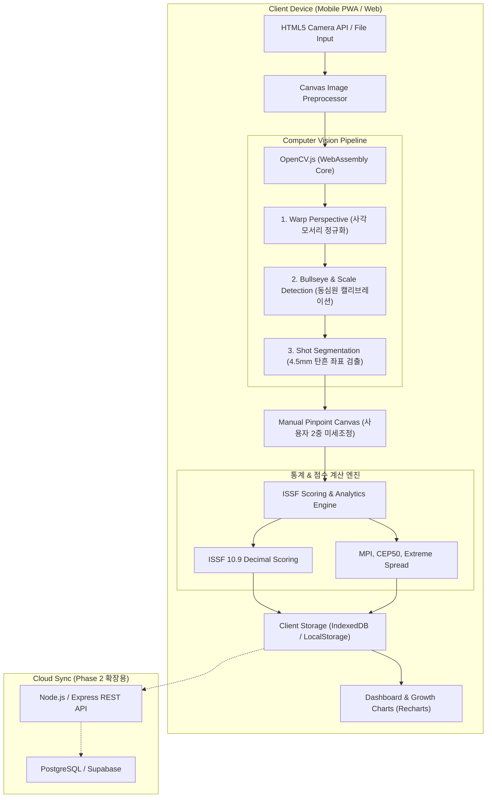

# 🛠️ [SYSTEM DESIGN] TargetScan AI 시스템 아키텍처 및 기술 설계서

- **문서 버전:** v1.0.0
- **작성일:** 2026-10-19
- **작성자:** 코다리 개발부장
- **기술 스택:** React 18, TypeScript, Tailwind CSS, HTML5 Canvas, OpenCV.js, Recharts, IndexedDB

---

## 1. 시스템 아키텍처 다이어그램 (Architecture Overview)

서버 비용을 극단적으로 아끼고(0원) 오프라인 지하 사격장에서도 동작하도록, **모든 이미지 연산과 저장을 클라이언트 브라우저(On-Device)에서 처리하는 린(Lean) 아키텍처**를 채택합니다.



---

## 2. 컴퓨터 비전 파이프라인 세부 알고리즘 (CV Pipeline Spec)

### 2.1 단계 1: 사각 왜곡 보정 (Warp Perspective)
- **입력:** 사용자가 폰으로 촬영한 원본 이미지 (RGB, 해상도 $1920 \times 1080$ 등)
- **처리 절차:**
  1. Grayscale 변환 ➔ Gaussian Blur ($5 \times 5, \sigma = 0$)
  2. Canny Edge Detection (`threshold1 = 50, threshold2 = 150`)
  3. `findContours`를 통한 외곽선 추출
  4. 다각형 근사(`approxPolyDP`)를 수행하여 꼭짓점 4개인 최대 면적 컨투어 선별
  5. 4개 꼭짓점 좌표를 `[좌상, 우상, 우하, 좌하]` 순서로 정렬
  6. $800 \times 800$ 픽셀 기준 사각형으로 `cv2.getPerspectiveTransform` 및 `cv2.warpPerspective` 수행
- **출력:** 정면 평면화된 $800 \times 800$ 정규화 이미지

### 2.2 단계 2: 중앙 흑점(Bullseye) 및 스케일 캘리브레이션
- **ISSF 공식 규격 기준:**
  - 10m 공기소총 표적의 중앙 검은 원(4~9점 영역) 지름: **$30.5\text{ mm}$ (반경 $15.25\text{ mm}$)**
  - 10점 링 지름: **$0.5\text{ mm}$ (반경 $0.25\text{ mm}$)**
  - 링 간격: 반경 방향으로 **$2.5\text{ mm}$**씩 증가
- **알고리즘:**
  1. 이진화(Binary Thresholding, 임계값 ~90)로 중앙 검은색 원 영역 마스킹
  2. `minEnclosingCircle` 또는 타원 피팅을 통해 검은색 원의 중심점 $(X_c, Y_c)$과 반경 $R_{px}$ 산출
  3. 픽셀-밀리미터 변환 비율 산출:
     $$\text{ScaleFactor} (\text{px/mm}) = \frac{R_{px}}{15.25\text{ mm}}$$

### 2.3 단계 3: 탄흔(4.5mm 납탄 구멍) 분할 및 검출
- **알고리즘:**
  1. 표적지 종이와 탄흔 구멍 사이의 대비를 강화하기 위해 `Adaptive Threshold` 적용
  2. 컨투어 검출 후 다음 필터링 조건 통과 여부 검사:
     - **물리적 반경 조건:**
       $$0.65 \times \left(2.25\text{ mm} \times \text{ScaleFactor}\right) \le R_{shot} \le 1.45 \times \left(2.25\text{ mm} \times \text{ScaleFactor}\right)$$
     - **원형도(Circularity) 조건:**
       $$\text{Circularity} = \frac{4 \pi \times \text{Area}}{\text{Perimeter}^2} \ge 0.58$$
  3. 탄흔 중심점 좌표 $(X_{shot}, Y_{shot})$ 리스트 추출

---

## 3. 사격 점수 및 실력 통계 수학 공식 (Mathematical Spec)

### 3.1 ISSF 소수점 점수 계산 공식
1. 중심점으로부터의 탄흔 유클리디안 물리 거리 $D_{mm}$:
   $$D_{mm} = \frac{\sqrt{(X_{shot} - X_c)^2 + (Y_{shot} - Y_c)^2}}{\text{ScaleFactor}}$$
2. ISSF 10.9 만점 소수점 환산식:
   $$\text{Score} = \begin{cases} 
   10.9 & \text{if } D_{mm} = 0 \\
   \max\left(0.0, 10.9 - \frac{D_{mm}}{0.25} \times 0.1\right) & \text{if } D_{mm} > 0 
   \end{cases}$$
   *(소수점 첫째 자리 반올림)*

### 3.2 탄착군(Grouping) 분석 메트릭
1. **MPI (Mean Point of Impact, 탄착 중심점):**
   $$\text{MPI}_x = \frac{1}{N} \sum_{i=1}^N \Delta X_i, \quad \text{MPI}_y = \frac{1}{N} \sum_{i=1}^N \Delta Y_i$$
   *(사수의 오조준/영점 편차를 나타내며, 조준기 클릭 수정 가이드로 직접 환산)*
2. **Extreme Spread (최대 분산도, mm):**
   $$\text{ES} = \max_{i \ne j} \sqrt{(X_i - X_j)^2 + (Y_i - Y_j)^2}_{\text{mm}}$$
### 3.3 백지사격(Blank Target) 전용 분석 알고리즘 & 수학 공식
1. **스케일 캘리브레이션 (동심원이 없는 경우):**
   - 사각형 표적지 외곽 너비($W_{card\_px}$)와 실제 규격($170\text{ mm}$ 등) 비율로 산출:
     $$\text{ScaleFactor} = \frac{W_{card\_px}}{170\text{ mm}}$$
   - 4.5mm 탄흔 구경을 통한 교차 검증: 검출된 탄흔들의 평균 반경 $R_{pellet\_px}$을 기준으로 $\text{ScaleFactor} \approx \frac{R_{pellet\_px}}{2.25\text{ mm}}$ 일치도 확인.
2. **가상 중심(Centroid) 산출:**
   $$\bar{X} = \frac{1}{N} \sum_{i=1}^N X_i, \quad \bar{Y} = \frac{1}{N} \sum_{i=1}^N Y_i$$
3. **가상 10점 센터링 점수 (Virtual Potential Score):**
   - 각 탄환과 가상 중심 사이의 거리 $D_{virtual\_i} = \frac{\sqrt{(X_i - \bar{X})^2 + (Y_i - \bar{Y})^2}}{\text{ScaleFactor}}$
   - 영점이 완벽하다고 가정할 때의 잠재 소수점 점수 환산:
     $$\text{Score}_{virtual\_i} = \max\left(0.0, 10.9 - \frac{D_{virtual\_i}}{0.25} \times 0.1\right)$$
4. **가로/세로 분산비($R_{disp}$) 및 AI 코칭 피드백 진단 로직:**
   $$\sigma_x = \sqrt{\frac{1}{N}\sum(X_i - \bar{X})^2}, \quad \sigma_y = \sqrt{\frac{1}{N}\sum(Y_i - \bar{Y})^2}, \quad R_{disp} = \frac{\sigma_x}{\sigma_y}$$
   - $R_{disp} < 0.7$ (세로 길쭉형): **"호흡 조절 미흡 또는 격발 시 총구 떨어짐(Flinching) 주의"**
   - $R_{disp} > 1.4$ (가로 넓은형): **"방아쇠 비틀림, 그립 악력 불안정, 총기 기울임(Canting) 점검 필요"**
   - $0.7 \le R_{disp} \le 1.4$ (동심원 조밀형): **"우수한 격발 및 파지 밸런스 유지 중"**

---

## 4. 데이터 모델 설계 (TypeScript Interfaces)

```typescript
// 사격 모드 구분
export type TargetMode = 
  | 'Official_AirRifle'          // 공식 10m 공기소총 표적
  | 'Official_AirPistol'         // 공식 10m 공기권총 표적
  | 'Blank_Training'             // 백지사격 훈련 모드
  | 'AirRifle_On_PistolTarget';  // 권총 표적지에 소총 사격 (소총 룰 환산 채점)

// 선수 정보
export interface Shooter {
  id: string;
  name: string;
  category: 'AirRifle_10m' | 'AirPistol_10m';
  createdAt: string;
}

// 개별 탄환 발사 데이터
export interface ShotPoint {
  id: string;
  shotNumber: number;
  pixelX: number;
  pixelY: number;
  offsetX_mm: number; // 중심 기준 좌우 편차 (+: 우, -: 좌)
  offsetY_mm: number; // 중심 기준 상하 편차 (+: 하, -: 상)
  distance_mm: number;
  score: number;       // ISSF 소수점 점수 (백지사격 시 가상 중심 점수)
  isManuallyAdjusted: boolean;
}

// 사격 세션 통계 및 메타데이터
export interface ShootingSession {
  id: string;
  shooterId: string;
  mode: TargetMode;     // 공식 표적 or 백지 사격 모드
  createdAt: string;
  targetImageUri?: string; // 보정된 표적지 썸네일
  targetScale: {
    centerX: number;     // 공식 표적 중심 or 백지 가상 무게중심
    centerY: number;
    pxPerMm: number;
  };
  shots: ShotPoint[];
  summary: {
    totalShots: number;
    totalScore: number;
    averageScore: number;
    mpiX_mm: number;      // 탄착군 중심 X 편차
    mpiY_mm: number;      // 탄착군 중심 Y 편차
    extremeSpread_mm: number; // 최대 분산 (mm)
    cep50_mm: number;     // 50% 집탄 반경 (mm)
    dispersionRatio?: number; // 가로/세로 분산비 (백지사격 전용)
    coachingAdvice?: string;  // AI 원포인트 피드백 멘트
  };
  memo?: string;
}
```

---

## 5. UI/UX 컴포넌트 아키텍처

```
src/
├── components/
│   ├── layout/
│   │   ├── Header.tsx            # 앱 타이틀, 네비게이션, 오프라인 상태 표시
│   │   └── TabNavigation.tsx     # [대시보드 / 스캔 / 기록] 하단 탭
│   ├── scanner/
│   │   ├── CameraViewfinder.tsx   # 웹캠/폰카메라 스트림 및 사각 가이드라인
│   │   ├── TargetCanvas.tsx       # 표적지 렌더러 + 탄착점 핀 + 드래그 앤 드롭
│   │   ├── PinAdjusterModal.tsx   # 탄착점 돋보기 확대 및 미세조정 조작계
│   │   └── ScoreTable.tsx         # 실시간 1~10발 점수 리스트
│   ├── dashboard/
│   │   ├── RecentSummaryCard.tsx  # 최근 세션 총점/평균 카드
│   │   ├── ScoreTrendChart.tsx    # 세션별 평균 점수 상승 추이선 (Recharts)
│   │   ├── GroupingTrendChart.tsx # 세션별 CEP50 집탄 축소 추이선 (Recharts)
│   │   └── SessionHistoryList.tsx # 지난 사격 기록 리스트
│   └── common/
│       └── StatCard.tsx           # 메트릭 표시 카드 컴포넌트
├── services/
│   ├── visionEngine.ts           # OpenCV.js 래퍼 (Warp, Bullseye, Pellet 검출)
│   ├── scoringEngine.ts          # ISSF 소수점 계산 및 통계(MPI, CEP50)
│   └── storageService.ts         # IndexedDB / LocalStorage CRUD
└── App.tsx                       # 메인 라우터 및 상태 관리
```

---

## 6. 잠재 기술적 리스크 & 코다리의 방어 설계 (Risk Management)

| 위험 요소 | 영향 | 코다리 부장의 기술적 방어책 |
| :--- | :--- | :--- |
| **1. 종이 찢어짐으로 인한 불규칙 탄흔** | 원형 필터링 탈락 또는 중심 오인식 | **수동 핀포인트 튜닝 모드:** AI가 1차 감지 후 사용자가 탭 한 번으로 핀 추가/삭제/이동 가능하도록 UI 설계 |
| **2. 조명 반사 및 어두운 사격장** | 외곽선 및 검은 원 검출 실패 | **적응형 이진화(Adaptive Threshold) & 사용자 수동 사각 모서리 피킹 기능** 제공 |
| **3. 탄흔 중첩 (Double Shot)** | 2발이 한 구멍으로 들어가 1발로 인식 | 컨투어 면적이 기준치의 1.7배 이상일 경우 자동으로 타원 분할(Ellipse Fitting) 혹은 2발 중첩 경고 알림 |
